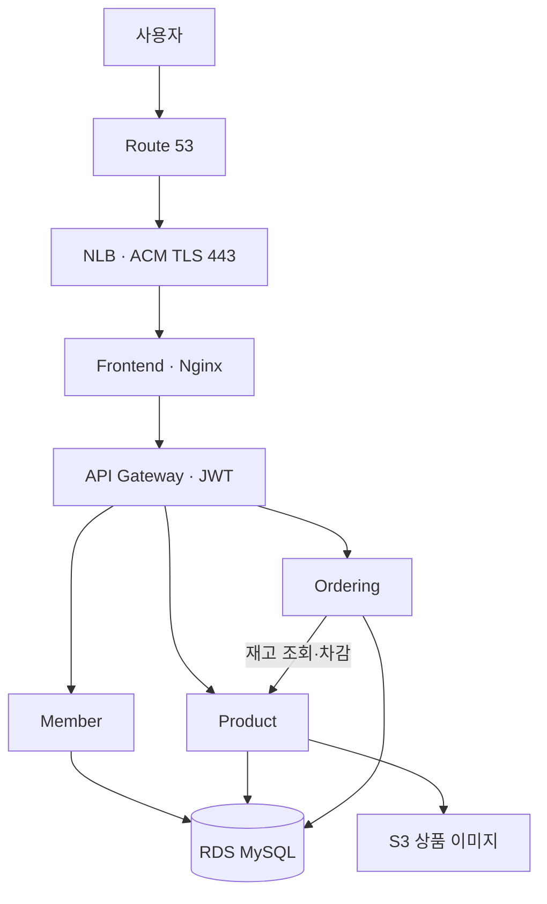

# 프로젝트 구성

## 어떤 프로젝트인가?

회원·상품·주문 서비스를 나눠 배포하고 AWS에서 배포·확장·관측·장애 대응을 연결하는 쇼핑몰 실습입니다.

## 사용자 요청 흐름



하나의 RDS 인스턴스 안에서 memberdb·productdb·orderingdb와 서비스별 사용자를 분리합니다. 서비스별 RDS 인스턴스를 각각 생성하는 구성은 아닙니다.

| 서비스 | 역할 |
|---|---|
| Frontend | 쇼핑몰 화면과 Nginx 프록시 |
| Gateway | JWT 확인, API 라우팅 |
| Member | 회원·로그인·주문자 이메일 내부 조회 |
| Product | 상품·이미지·재고 |
| Ordering | 주문 저장, 재고 호출, 주문 이벤트 |

## 비동기 주문 알림

```text
주문 DB 커밋
→ 회원 이메일 조회·SNS 발행
→ SQS
→ Lambda
→ SES
→ 주문자 메일

처리 실패 반복 → DLQ
```

주문 접수 알림이며 결제 승인 알림은 아닙니다. Outbox·영속 중복 방지는 아직 없습니다.

## 플랫폼 역할

- HPA: CPU 사용률을 기준으로 Pod 수 조절
- Cluster Autoscaler: 배치할 자원이 부족한 Pod 등을 고려해 노드 수 조절
- Metrics Server: HPA가 사용할 자원 사용량 제공
- ExternalDNS: Service 정보를 기반으로 Route 53 갱신
- Pod Identity: 서비스별 AWS 권한 연결
- AWS LBC: Frontend Service를 보고 NLB 생성

CPU 30%는 노드 전체가 아니라 Pod CPU requests 대비 비율입니다.

## 원래 구상도와 다른 부분

| 구상도 | 현재 구현 |
|---|---|
| ALB·Ingress | NLB·Frontend Nginx |
| Ingress를 통한 모니터링 접근 | ClusterIP·로컬 포트포워딩 |
| 정상 Pod 확장 알림 | 아직 없음. 현재는 장애·가용성 알림 |
| 노드 확장 알림 | EventBridge·SNS 구성, 실제 수신 시험 미완료 |
| 플랫폼까지 Terraform 관리 | AWS는 Terraform, 플랫폼은 PowerShell·Helm |

Lambda는 구상도에서 허용한 주문 소비자 구현 방식 중 하나입니다.

현재 구조는 구상도와 차이가 있으므로 기존 구상도를 현재 배포 구조로 그대로 표시하지 않습니다.

[프로젝트 홈](../README.md) · [다음: 배포 자동화](02-deployment.md)
